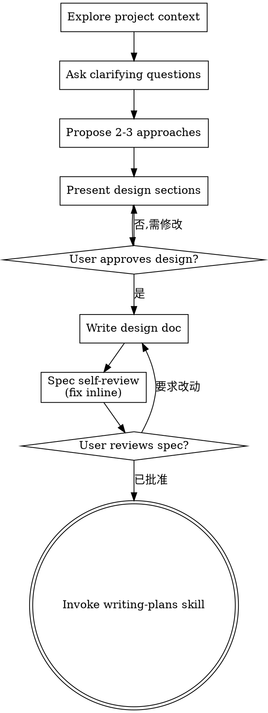

# 把点子头脑风暴成设计

通过自然的协作式对话,帮你把点子打磨成成型的设计和 spec。

先从理解当前项目的上下文入手,然后一次问一个问题,逐步把点子打磨清楚。等你搞明白要做的是什么,把设计拿出来给用户过目并获得批准。

<HARD-GATE>
在你拿出设计、并且用户已经批准之前,不要调用任何实现类技能、不要写任何代码、不要搭任何项目脚手架、也不要采取任何实现动作。这条对每个项目都适用,不管它看起来有多简单。
</HARD-GATE>

## 反模式:"这也太简单了,不用做设计"

每个项目都要走这套流程。一个待办清单、一个单函数小工具、一处配置改动——统统都要。恰恰是"简单"项目里那些没被审视过的假设,最容易造成白忙活。设计可以很短(对真正简单的项目,几句话就够),但你必须把它拿出来并获得批准。

## 清单

下面每一项你都必须创建一个任务,并按顺序完成:

1. **摸清项目上下文** —— 看看文件、文档、最近的提交
2. **在恰当时机顺势提供可视化助手(visual companion)** —— 不要一上来就提。当第一次遇到某个问题"展示出来"确实比"描述出来"更清楚时,再顺势提出(单独发一条消息);用户同意后,它的浏览器标签页会为你打开。如果始终没冒出适合可视化的问题,那就永远别提。见下方 Visual Companion 一节。
3. **提出澄清性问题** —— 一次一个,搞清楚目的/约束/成功标准
4. **提出 2-3 个方案** —— 附上各自的取舍,以及你的推荐
5. **拿出设计** —— 按各部分复杂度分段呈现,每一段之后都拿到用户批准
6. **写设计文档** —— 保存到 `docs/superpowers/specs/YYYY-MM-DD-<topic>-design.md` 并提交
7. **spec 自审** —— 快速就地检查占位符、自相矛盾、含糊、范围(见下文)
8. **用户评审写好的 spec** —— 继续往下之前,请用户评审 spec 文件
9. **过渡到实现** —— 调用 writing-plans 技能来创建实现计划

## 流程图

**终态是调用 writing-plans。** 不要调用 frontend-design、mcp-builder 或任何其他实现类技能。头脑风暴之后你唯一会调用的技能就是 writing-plans。

## 具体流程

**理解这个点子:**

- 先看看项目当前的状态(文件、文档、最近的提交)
- 在问细节问题之前,先评估范围:如果需求描述的是多个相互独立的子系统(比如"做一个带聊天、文件存储、计费和分析的平台"),立刻把这一点标出来。别把宝贵的提问花在打磨一个本该先拆解的项目的细节上。
- 如果项目大到一份 spec 装不下,帮用户拆成子项目:哪些是彼此独立的部分,它们之间怎么关联,应该按什么顺序来做?然后走正常设计流程,先对第一个子项目做头脑风暴。每个子项目各自走一遍 spec → 计划 → 实现的循环。
- 对于范围合适的项目,一次问一个问题,逐步把点子打磨清楚
- 尽量用选择题的形式,不过开放式问题也没问题
- 每条消息只问一个问题 —— 如果某个话题需要更深入,就把它拆成多个问题
- 聚焦于理解:目的、约束、成功标准

**探索方案:**

- 提出 2-3 个不同的方案,附上各自的取舍
- 以对话的方式呈现选项,给出你的推荐和理由
- 先亮出你推荐的那个选项,并解释为什么
- 无情地贯彻 YAGNI —— 从每个方案和设计里砍掉不必要的功能

**拿出设计:**

- 一旦你相信自己搞明白了要做什么,就把设计拿出来
- 每个部分的篇幅要与其复杂度相称:简单的几句话带过,微妙的可以写到 200-300 字
- 每一段之后都问问,到目前为止看起来对不对
- 覆盖:架构、组件、数据流、错误处理、测试
- 如果有什么说不通,随时准备回头澄清

**为隔离性和清晰度而设计:**

- 把系统拆成更小的单元,每个单元只有一个明确的职责,通过定义良好的接口通信,并且可以被独立理解和测试
- 对每个单元,你都应该能回答:它做什么、怎么用、它依赖什么?
- 别人能不能不看内部实现就理解一个单元在做什么?你能不能在不破坏调用方的前提下改动它的内部实现?如果不能,说明边界还需要打磨。
- 更小、边界更清晰的单元对你自己干活也更友好 —— 你对能一次装进上下文的代码推理得更好,而且当文件足够聚焦时,你的改动也更可靠。当一个文件变得很大,那往往是个信号:它承担的东西太多了。

**在既有代码库中工作:**

- 在提出改动之前,先摸清当前的结构。沿用既有的模式。
- 如果既有代码存在会影响本次工作的问题(比如某个文件长得太大、边界不清、职责纠缠在一起),就把有针对性的改进纳入设计 —— 就像一个好开发者会顺手改进自己正在动的代码那样。
- 不要提出不相关的重构。始终聚焦在服务于当前目标的事情上。

## 设计之后

**文档化:**

- 把校验过的设计(spec)写到 `docs/superpowers/specs/YYYY-MM-DD-<topic>-design.md`
  - (用户对 spec 存放位置的偏好会覆盖这个默认值)
- 如果有 elements-of-style:writing-clearly-and-concisely 技能,就用它
- 把设计文档提交到 git

**spec 自审:**
写完 spec 文档后,用一双"新鲜的眼睛"再看一遍:

1. **占位符扫描:** 有没有 "TBD"、"TODO"、没写完的小节,或含糊的需求?修掉它们。
2. **内部一致性:** 有没有哪几节自相矛盾?架构和功能描述对得上吗?
3. **范围检查:** 这份 spec 是否足够聚焦、能对应单份实现计划,还是需要拆解?
4. **含糊检查:** 有没有哪条需求能被解读成两种意思?如果有,选定一种,并把它写明确。

发现问题就地修掉。不用再评审一遍 —— 修完接着往下走就行。

**用户评审关卡:**
spec 自审循环通过之后,继续往下之前请用户评审写好的 spec:

> "spec 已写好并提交到 `<path>`。请你评审一下,在我们开始写实现计划之前,告诉我你想不想改点什么。"

等用户回复。如果他们要求改动,就改掉,然后重新走一遍 spec 自审循环。只有在用户批准后才继续。

**实现:**

- 调用 writing-plans 技能来创建一份详细的实现计划
- 不要调用任何其他技能。下一步就是 writing-plans。

## Visual Companion

一个基于浏览器的助手,用于在头脑风暴过程中展示原型图、示意图和可视化选项。它是一个**工具**,不是一种模式。接受这个助手意味着它对那些适合可视化处理的问题可用;它**不**意味着每个问题都要走浏览器。

**提供这个助手(恰当时机):** 不要一上来就提。等到某个问题"展示出来"确实比"讲出来"更清楚时再提 —— 是真正的原型图 / 布局 / 示意图问题,而不仅仅是一个 UI *话题*。第一次遇到这种情况时,再顺势提出,并且单独发一条消息:

> "接下来这部分可能我展示给你看会更容易 —— 我可以在浏览器标签页里边聊边给你拼原型图、示意图和对比。这功能还比较新,而且可能比较费 token。要我开吗?我来帮你打开。"

**这条提议必须是单独的一条消息。** 只有提议 —— 不夹带澄清性问题、总结或其他内容。等用户回复。如果他们接受,用 `--open` 启动服务,这样他们的浏览器会自动打开到第一个界面。如果他们拒绝,就继续纯文本方式,别再提了,除非他们自己提起。

**逐题决策:** 即便用户已经接受,也要**对每一个问题**单独决定用浏览器还是用终端。判断标准:**用户是"看到它"更容易理解,还是"读到它"更容易理解?**

- **用浏览器**呈现那些本身就是可视化的内容 —— 原型图、线框图、布局对比、架构示意图、并排的视觉设计
- **用终端**呈现那些本质是文本的内容 —— 需求类问题、概念性选择、取舍清单、A/B/C/D 文字选项、范围决策

一个关于 UI 话题的问题,并不自动就是一个可视化问题。"在这个语境里 personality 是什么意思?"是概念性问题 —— 用终端。"哪个向导布局更好?"是可视化问题 —— 用浏览器。

如果他们同意用这个助手,在继续之前先读一读详细指南:
`skills/brainstorming/visual-companion.md`
