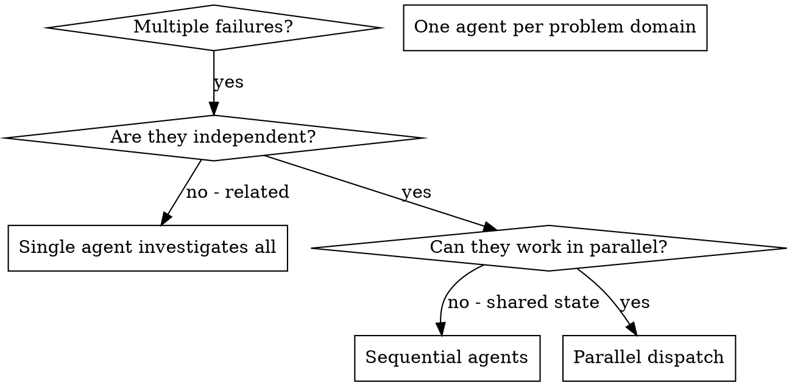

# Dispatching Parallel Agents

## 概述

你把任务委派给拥有独立上下文的专职 Agent。通过精心设计它们的指令和上下文,你确保它们保持专注、把任务做成。它们绝不应该继承你会话的上下文或历史——你要精确地为它们构造好所需的一切。这样也能把你自己的上下文保留下来,用于协调工作。

当你遇到多个互不相关的失败(不同的测试文件、不同的子系统、不同的 bug)时,一个一个顺序排查会浪费时间。每一项排查都是独立的,可以并行进行。

**核心原则:** 每个独立的问题域派一个 Agent。让它们并发地干活。

## 何时使用



**适合使用的场景:**
- 3 个以上测试文件失败,且根因各不相同
- 多个子系统各自独立地坏掉了
- 每个问题都能在不依赖其他问题上下文的情况下被理解
- 各项排查之间没有共享状态

**不要使用的场景:**
- 各个失败彼此相关(修一个可能就顺带修好其他的)
- 需要理解整个系统的完整状态
- 多个 Agent 会互相干扰

## 模式

### 1. 识别独立的问题域

按"坏在哪儿"给失败分组:
- 文件 A 的测试:工具审批流程
- 文件 B 的测试:批处理完成行为
- 文件 C 的测试:中断功能

每个域都是独立的——修复工具审批不会影响中断相关的测试。

### 2. 创建聚焦的 Agent 任务

每个 Agent 都拿到:
- **明确的范围:** 一个测试文件或一个子系统
- **清晰的目标:** 让这些测试通过
- **约束条件:** 不要改动其他代码
- **预期产出:** 一份"你发现了什么、修了什么"的总结

### 3. 并行派发

在同一条回复里发出全部三个子 Agent 派发——它们会并行运行:

```text
Subagent (general-purpose): "Fix agent-tool-abort.test.ts failures"
Subagent (general-purpose): "Fix batch-completion-behavior.test.ts failures"
Subagent (general-purpose): "Fix tool-approval-race-conditions.test.ts failures"
# All three run concurrently.
```

一条回复里多个派发调用 = 并行执行。一条回复一个 = 顺序执行。

### 4. 评审与整合

当各 Agent 返回时:
- 读每一份总结
- 核实这些修复彼此不冲突
- 运行完整测试套件
- 整合所有改动

## Agent Prompt 结构

好的 Agent prompt 应当:
1. **聚焦** - 一个清晰的问题域
2. **自包含** - 理解这个问题所需的全部上下文都齐了
3. **对产出有明确要求** - Agent 该返回什么?

```markdown
Fix the 3 failing tests in src/agents/agent-tool-abort.test.ts:

1. "should abort tool with partial output capture" - expects 'interrupted at' in message
2. "should handle mixed completed and aborted tools" - fast tool aborted instead of completed
3. "should properly track pendingToolCount" - expects 3 results but gets 0

These are timing/race condition issues. Your task:

1. Read the test file and understand what each test verifies
2. Identify root cause - timing issues or actual bugs?
3. Fix by:
   - Replacing arbitrary timeouts with event-based waiting
   - Fixing bugs in abort implementation if found
   - Adjusting test expectations if testing changed behavior

Do NOT just increase timeouts - find the real issue.

Return: Summary of what you found and what you fixed.
```

## 常见错误

**❌ 太宽泛:** "Fix all the tests"——Agent 会迷失方向
**✅ 具体:** "Fix agent-tool-abort.test.ts"——范围聚焦

**❌ 没上下文:** "Fix the race condition"——Agent 不知道在哪儿
**✅ 有上下文:** 把报错信息和测试名贴上去

**❌ 没约束:** Agent 可能把一切都重构一遍
**✅ 有约束:** "Do NOT change production code" 或 "Fix tests only"

**❌ 产出含糊:** "Fix it"——你根本不知道改了什么
**✅ 具体:** "Return summary of root cause and changes"

## 何时不要使用

**相关联的失败:** 修一个可能就把其他的也修好了——先一起排查
**需要完整上下文:** 想弄懂必须看到整个系统
**探索式调试:** 你还不知道哪儿坏了
**共享状态:** Agent 之间会互相干扰(改同一批文件、用同一批资源)

## 来自真实会话的例子

**场景:** 大规模重构后,横跨 3 个文件的 6 个测试失败

**失败清单:**
- agent-tool-abort.test.ts:3 个失败(时序问题)
- batch-completion-behavior.test.ts:2 个失败(工具没执行)
- tool-approval-race-conditions.test.ts:1 个失败(执行次数 = 0)

**判断:** 是独立的问题域——中断逻辑、批处理完成、竞态条件互不相干

**派发:**
```
Agent 1 → Fix agent-tool-abort.test.ts
Agent 2 → Fix batch-completion-behavior.test.ts
Agent 3 → Fix tool-approval-race-conditions.test.ts
```

**结果:**
- Agent 1:用基于事件的等待替换了固定超时
- Agent 2:修了事件结构的 bug(threadId 放错了位置)
- Agent 3:补上了对异步工具执行完成的等待

**整合:** 所有修复彼此独立,无冲突,完整套件全绿

## 验证

各 Agent 返回后:
1. **读每一份总结** - 理解改了什么
2. **检查冲突** - Agent 们是不是改了同一段代码?
3. **运行完整套件** - 核实所有修复能协同工作
4. **抽查** - Agent 可能会犯系统性的错误
