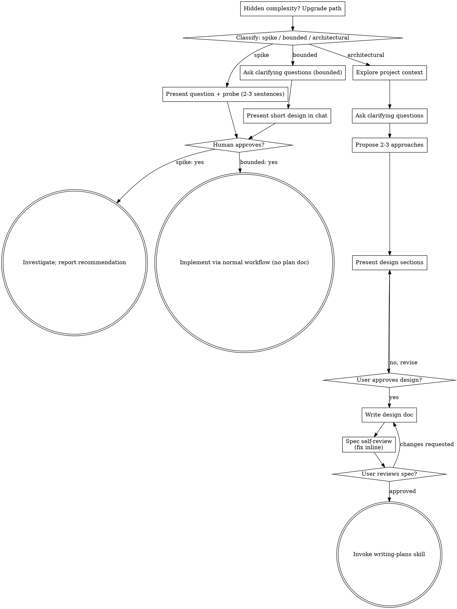

# 把点子头脑风暴成设计

通过自然的协作式对话,帮你把点子打磨成成型的设计和 spec。

先判断请求需要多重的流程,然后沿相应路径推进:理解上下文、打磨想法、提出设计,并取得你的人类搭档批准。

<HARD-GATE>
在你向人类搭档说明打算怎么做、并获得批准之前,不要调用任何实现类技能、不要写任何代码、不要搭任何项目脚手架,也不要采取任何实现动作。下述每条路径、每项任务都适用——仪式可以随任务缩放,批准关卡永远不能省。
</HARD-GATE>

## 三条路径

在提出第一个问题之前,先给请求分类并明确说出来——例如“这看起来是一个边界明确的任务,所以我会在对话中给出简短设计,而不是编写 spec”——以便你的人类搭档纠正:

- **探索(Spike)** —— 可行性问题(“能不能……”“是否可行……”“快速粗糙地试一下即可”),其产出是答案,而不是要保留的代码。用 2-3 句话说明问题和准备怎样验证,得到首肯后,在保证结论正确的前提下用成本最低的方式查明。无需设计文档或 spec 文件。以建议形式报告发现;期间构建的任何东西都必须标为一次性产物。
- **边界明确(Bounded)** —— 对仓库中既有代码的一项范围清晰的改动,例如新增一个标志位、一个小接口或修复一个文件。熟悉这类应用并不等于边界明确——你要修改的流程必须已经存在于仓库中、可以直接阅读;没有既有流程可改,就不属于这一类。只问真正有影响的澄清问题,然后**在对话中**给出简短设计(几句话到几个短段落),并停下来。只有人类搭档明确同意设计后才能开始实现——边界明确任务的批准关卡与架构型任务同样严格。无需 spec 文件或实现计划文档。
- **架构型(Architectural)** —— 新项目、新子系统、重构组件组合方式,或改变其他方依赖接口的改动。走完整流程:提问、比较方案、分段设计、书面 spec,再调用 writing-plans 技能。

如果在两条路径之间犹豫,选择更重的那条。这个棘轮只能向上:任务中途发现隐藏复杂度时,必须停下来说明情况并升级路径;不能在中途降级。

## 反模式:“太简单,不需要批准”

每条路径在实现前都必须以人类搭档批准你的意图收尾。待办清单、单函数工具、配置改动——设计或许只需对话中的两句话,但你**必须**先展示并获得批准。“简单”任务最容易因未经检验的假设而浪费工作。可以随简单程度缩减的是产物,绝不是批准。

## 危险信号

| 想法 | 现实 |
|------|------|
| “这太简单了,不需要设计” | 简单意味着短设计,不是没有设计。在对话中写两句话,然后等批准。 |
| “我把它叫作边界明确,就能跳过 spec” | 想借标签省步骤本身就是疑点——选择更重的路径。 |
| “范围明确而且设计显而易见——他们阅读时我先开工” | 关卡在于批准,不在于设计篇幅。先展示,然后停下等明确同意。 |
| “我熟悉这类应用,所以它边界明确” | 边界是否明确看仓库,不看你的熟悉程度。新项目没有既有流程,属于架构型任务。 |
| “探索成功了,所以我就保留这段代码” | 探索的产出是答案。保留代码是一个新请求——重新分类。 |
| “任务变大了,但我快做完了——不用重新分类” | 隐藏复杂度会使路径升级。停下来并说明情况。 |
| “他们批准了探索,所以后续改动也算批准了” | 每项任务都要单独分类、单独获得批准。 |

## 清单

先分类、宣布路径,然后为该路径的每一项创建任务并按顺序完成。

**探索:**
1. **摸清项目上下文** —— 足以界定验证问题即可
2. **展示问题与验证计划** —— 2-3 句话
3. **获得批准** —— 点头同意即可
4. **开展调查** —— 在保证结论正确的前提下尽量低成本
5. **报告发现** —— 给出建议;任何构建产物都标为一次性

**边界明确:**
1. **摸清项目上下文** —— 查看文件、文档、最近提交
2. **提出澄清性问题** —— 一次一个,只问有影响的问题
3. **在对话中给出短设计** —— 方法、涉及文件、测试方式
4. **获得批准** —— 停下来等待明确的“同意”;展示设计的同时就开工等同于跳过关卡
5. **实现** —— 按常规开发流程推进(TDD 仍然适用);不写计划文档

**架构型:**
1. **摸清项目上下文** —— 查看文件、文档、最近提交
2. **在恰当时机顺势提供可视化助手(visual companion)** —— 不要一上来就提。当第一次遇到某个问题“展示出来”确实比“描述出来”更清楚时,再单独发消息提议;用户同意后,浏览器标签页会打开。如果始终没有适合可视化的问题,就永远别提。见下方 Visual Companion 一节。
3. **提出澄清性问题** —— 一次一个,搞清楚目的、约束和成功标准
4. **提出 2-3 个方案** —— 附上取舍与推荐方案
5. **拿出设计** —— 按复杂度分段展示,每段之后取得用户批准
6. **写设计文档** —— 保存到 `docs/superpowers/specs/YYYY-MM-DD-<topic>-design.md` 并提交
7. **spec 自审** —— 快速就地检查占位符、矛盾、歧义和范围(见下文)
8. **用户评审书面 spec** —— 继续前请用户评审 spec 文件
9. **过渡到实现** —— 调用 writing-plans 技能创建实现计划

## 流程图

**终态由路径决定。** 架构型:头脑风暴后唯一调用的技能是 writing-plans——不要调用 frontend-design、mcp-builder 或其他实现类技能。边界明确:获得批准后直接进入常规开发流程,不写计划文档。探索:终态是报告建议。

## 具体流程

下面各小节适用于边界明确与架构型路径(探索路径在“展示验证方案并获得首肯”之后转入调查)。从**探索方案**开始的内容属于架构型深度——对于边界明确的工作,了解上下文、提出几个问题并在对话中给出短设计,就是完整流程。

**理解这个点子:**

- 先看看项目当前的状态(文件、文档、最近的提交)
- 在问细节问题之前,先评估范围:如果需求描述的是多个相互独立的子系统(比如"做一个带聊天、文件存储、计费和分析的平台"),立刻把这一点标出来。别把宝贵的提问花在打磨一个本该先拆解的项目的细节上。
- 如果项目大到一份 spec 装不下,帮用户拆成子项目:哪些是彼此独立的部分,它们之间怎么关联,应该按什么顺序来做?然后走正常设计流程,先对第一个子项目做头脑风暴。每个子项目各自走一遍 spec → 计划 → 实现的循环。
- 对于范围合适的项目,一次问一个问题,逐步把点子打磨清楚
- 尽量用选择题的形式,不过开放式问题也没问题
- 每条消息只问一个问题 —— 如果某个话题需要更深入,就把它拆成多个问题
- 聚焦于理解:目的、约束、成功标准

**探索方案:**

- 提出 2-3 个不同的方案,附上各自的取舍
- 以对话的方式呈现选项,给出你的推荐和理由
- 先亮出你推荐的那个选项,并解释为什么
- 无情地贯彻 YAGNI —— 从每个方案和设计里砍掉不必要的功能

**拿出设计:**

- 一旦你相信自己搞明白了要做什么,就把设计拿出来
- 每个部分的篇幅要与其复杂度相称:简单的几句话带过,微妙的可以写到 200-300 字
- 每一段之后都问问,到目前为止看起来对不对
- 覆盖:架构、组件、数据流、错误处理、测试
- 如果有什么说不通,随时准备回头澄清

**为隔离性和清晰度而设计:**

- 把系统拆成更小的单元,每个单元只有一个明确的职责,通过定义良好的接口通信,并且可以被独立理解和测试
- 对每个单元,你都应该能回答:它做什么、怎么用、它依赖什么?
- 别人能不能不看内部实现就理解一个单元在做什么?你能不能在不破坏调用方的前提下改动它的内部实现?如果不能,说明边界还需要打磨。
- 更小、边界更清晰的单元对你自己干活也更友好 —— 你对能一次装进上下文的代码推理得更好,而且当文件足够聚焦时,你的改动也更可靠。当一个文件变得很大,那往往是个信号:它承担的东西太多了。

**在既有代码库中工作:**

- 在提出改动之前,先摸清当前的结构。沿用既有的模式。
- 如果既有代码存在会影响本次工作的问题(比如某个文件长得太大、边界不清、职责纠缠在一起),就把有针对性的改进纳入设计 —— 就像一个好开发者会顺手改进自己正在动的代码那样。
- 不要提出不相关的重构。始终聚焦在服务于当前目标的事情上。

## 设计之后(架构型路径)

**文档化:**

- 把校验过的设计(spec)写到 `docs/superpowers/specs/YYYY-MM-DD-<topic>-design.md`
  - (用户对 spec 存放位置的偏好会覆盖这个默认值)
- 如果有 elements-of-style:writing-clearly-and-concisely 技能,就用它
- 把设计文档提交到 git

**spec 自审:**
写完 spec 文档后,用一双"新鲜的眼睛"再看一遍:

1. **占位符扫描:** 有没有 "TBD"、"TODO"、没写完的小节,或含糊的需求?修掉它们。
2. **内部一致性:** 有没有哪几节自相矛盾?架构和功能描述对得上吗?
3. **范围检查:** 这份 spec 是否足够聚焦、能对应单份实现计划,还是需要拆解?
4. **含糊检查:** 有没有哪条需求能被解读成两种意思?如果有,选定一种,并把它写明确。

发现问题就地修掉。不用再评审一遍 —— 修完接着往下走就行。

**用户评审关卡:**
spec 自审循环通过之后,继续往下之前请用户评审写好的 spec:

> "spec 已写好并提交到 `<path>`。请你评审一下,在我们开始写实现计划之前,告诉我你想不想改点什么。"

等用户回复。如果他们要求改动,就改掉,然后重新走一遍 spec 自审循环。只有在用户批准后才继续。

**实现:**

- 调用 writing-plans 技能来创建一份详细的实现计划
- 不要调用任何其他技能。下一步就是 writing-plans。

## Visual Companion

一个基于浏览器的助手,用于在头脑风暴过程中展示原型图、示意图和可视化选项。它是一个**工具**,不是一种模式。接受这个助手意味着它对那些适合可视化处理的问题可用;它**不**意味着每个问题都要走浏览器。

**提供这个助手(恰当时机):** 不要一上来就提。等到某个问题"展示出来"确实比"讲出来"更清楚时再提 —— 是真正的原型图 / 布局 / 示意图问题,而不仅仅是一个 UI *话题*。第一次遇到这种情况时,再顺势提出,并且单独发一条消息:

> "接下来这部分可能我展示给你看会更容易 —— 我可以在浏览器标签页里边聊边给你拼原型图、示意图和对比。这功能还比较新,而且可能比较费 token。要我开吗?我来帮你打开。"

**这条提议必须是单独的一条消息。** 只有提议 —— 不夹带澄清性问题、总结或其他内容。等用户回复。如果他们接受,用 `--open` 启动服务,这样他们的浏览器会自动打开到第一个界面。如果他们拒绝,就继续纯文本方式,别再提了,除非他们自己提起。

**逐题决策:** 即便用户已经接受,也要**对每一个问题**单独决定用浏览器还是用终端。判断标准:**用户是"看到它"更容易理解,还是"读到它"更容易理解?**

- **用浏览器**呈现那些本身就是可视化的内容 —— 原型图、线框图、布局对比、架构示意图、并排的视觉设计
- **用终端**呈现那些本质是文本的内容 —— 需求类问题、概念性选择、取舍清单、A/B/C/D 文字选项、范围决策

一个关于 UI 话题的问题,并不自动就是一个可视化问题。"在这个语境里 personality 是什么意思?"是概念性问题 —— 用终端。"哪个向导布局更好?"是可视化问题 —— 用浏览器。

如果他们同意用这个助手,在继续之前先读一读详细指南:
`visual-companion.md`
