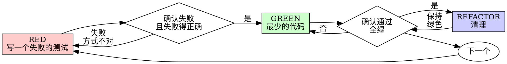

# 测试驱动开发(TDD)

## 概述

先写测试。看着它失败。再写最少的代码让它通过。

**核心原则:** 如果你没亲眼看着测试失败,你就不知道它测的到底对不对。

**违反规则的字面意思,就是违反规则的精神。**

## 何时使用

**永远都用:**
- 新功能
- 修 bug
- 重构
- 行为变更

**例外(要问过你的人类搭档):**
- 用完就扔的原型
- 生成的代码
- 配置文件

心里冒出"就这一次跳过 TDD 吧"?停。那是在给自己找借口。

## 铁律

```
没有先写一个失败的测试,就不准写生产代码
```

在测试之前写了代码?删掉。从头再来。

**没有例外:**
- 别留着当"参考"
- 别一边写测试一边"改改就用"
- 别去看它
- 删就是删

从测试出发,重新实现。就这样。

## 红-绿-重构



### RED - 写一个失败的测试

写一个最小的测试,展示应该发生什么。

<Good>
```typescript
test('retries failed operations 3 times', async () => {
  let attempts = 0;
  const operation = () => {
    attempts++;
    if (attempts < 3) throw new Error('fail');
    return 'success';
  };

  const result = await retryOperation(operation);

  expect(result).toBe('success');
  expect(attempts).toBe(3);
});
```
名字清晰,测的是真实行为,只测一件事
</Good>

<Bad>
```typescript
test('retry works', async () => {
  const mock = jest.fn()
    .mockRejectedValueOnce(new Error())
    .mockRejectedValueOnce(new Error())
    .mockResolvedValueOnce('success');
  await retryOperation(mock);
  expect(mock).toHaveBeenCalledTimes(3);
});
```
名字含糊,测的是 mock 而不是代码
</Bad>

**要求:**
- 一个行为
- 名字清晰
- 真实代码(除非实在避不开,否则不用 mock)

### 确认 RED - 看着它失败

**必做。永远别跳过。**

```bash
npm test path/to/test.test.ts
```

确认:
- 测试是失败(fail),不是报错(error)
- 失败信息符合预期
- 失败是因为功能还没实现(不是因为拼写错误)

**测试通过了?** 那你测的是已有的行为。改测试。

**测试报错了?** 修掉错误,重跑,直到它以正确的方式失败。

### GREEN - 最少的代码

写最简单的代码让测试通过。

<Good>
```typescript
async function retryOperation<T>(fn: () => Promise<T>): Promise<T> {
  for (let i = 0; i < 3; i++) {
    try {
      return await fn();
    } catch (e) {
      if (i === 2) throw e;
    }
  }
  throw new Error('unreachable');
}
```
刚好够通过
</Good>

<Bad>
```typescript
async function retryOperation<T>(
  fn: () => Promise<T>,
  options?: {
    maxRetries?: number;
    backoff?: 'linear' | 'exponential';
    onRetry?: (attempt: number) => void;
  }
): Promise<T> {
  // YAGNI
}
```
过度设计
</Bad>

别加功能,别重构别的代码,也别做超出测试要求的"改进"。

### 确认 GREEN - 看着它通过

**必做。**

```bash
npm test path/to/test.test.ts
```

确认:
- 测试通过
- 其他测试仍然通过
- 输出干干净净(没有报错、没有警告)

**测试失败了?** 改代码,别改测试。

**其他测试挂了?** 现在就修。

### REFACTOR - 清理

只在绿灯之后做:
- 消除重复
- 改好命名
- 抽出辅助函数

保持测试绿色。别加新行为。

### 重复

为下一个功能写下一个失败的测试。

## 好的测试

| 品质 | 好 | 坏 |
|---------|------|-----|
| **最小** | 只测一件事。名字里带"and"?拆开它。 | `test('validates email and domain and whitespace')` |
| **清晰** | 名字描述行为 | `test('test1')` |
| **体现意图** | 展示你想要的 API | 让人看不出代码该干什么 |

写或改任何测试时,读一读 [writing-good-tests.md](writing-good-tests.md),里面有让测试保持诚实的规则:
- 在写测试之前,先说出哪个生产代码的改动会让这个测试失败
- 断言真实行为,永远别断言 mock 的行为
- 只给测试用的代码放进测试工具里,别塞进生产类中
- 在 mock 一个依赖之前,先搞清楚它的副作用

## 常见的自我合理化

| 借口 | 现实 |
|--------|------|
| "太简单了,不用测" | 简单的代码也会坏。写测试只花 30 秒。 |
| "我之后再补测试" | 事后补的测试一上来就通过——而这什么都证明不了。它可能测错了东西,可能测的是实现而不是行为,也可能漏掉了你忘记的边界情况。你从没看它失败过,所以你从没证明过它能抓住 bug。测试先行会逼出那次失败。 |
| "事后补测试能达到同样的目的(重精神不重形式)" | 事后补的测试回答的是"这段代码做了什么";测试先行回答的是"这段代码应该做什么"。事后写的测试会被你已经写好的代码带偏——你验证的是你记得的那些情况,而不是你本会发现的那些。有覆盖率,却没有证明测试真的有用。 |
| "我已经手动测过了" | 手动测试是临时的:没有记录你覆盖了什么,代码一改就没法重跑,压力之下很容易漏掉某些情况。"我试的时候是好的"不等于全面。自动化测试每次都以同样的方式运行。 |
| "删掉这 X 小时太浪费了" | 沉没成本谬误——那些时间无论如何都已经花掉了。真正的选择是:用 TDD 重写(高信心)还是留着它再事后硬塞测试(低信心,大概率有 bug)。留着你信不过的代码才是真浪费。 |
| "留着当参考,先写测试" | 你会去改它。那就是事后补测试。删就是删。 |
| "得先探索一下" | 可以。把探索的代码扔掉,用 TDD 重新开始。 |
| "测起来难 = 设计不清楚" | 听测试的话。难测 = 难用。 |
| "TDD 会拖慢我" | TDD 才是务实的路:在提交前就抓住 bug,防止回归,让你能毫无顾虑地重构。"务实"的捷径意味着在生产环境里调试——更慢,不是更快。 |
| "手动测更快" | 手动测证明不了边界情况。而且每改一次你都得重测。 |
| "现有代码本来就没测试" | 你正在改进它。给现有代码补上测试。 |

## 危险信号 - 停,然后从头再来

- 先写代码再写测试
- 在实现之后才写测试
- 测试一上来就通过
- 说不清楚测试为什么失败
- 测试"以后再补"
- 给自己找借口"就这一次"
- "我已经手动测过了"
- "事后补测试能达到同样的目的"
- "这是重精神不重形式的问题"
- "留着当参考"或"改改现有代码就用"
- "已经花了 X 小时,删掉太浪费"
- "TDD 太教条了,我这是务实"
- "这次不一样,因为……"

**以上所有情况都意味着:删掉代码。用 TDD 从头再来。**

## 示例:修 bug

**Bug:** 空邮箱被接受了

**RED**
```typescript
test('rejects empty email', async () => {
  const result = await submitForm({ email: '' });
  expect(result.error).toBe('Email required');
});
```

**确认 RED**
```bash
$ npm test
FAIL: expected 'Email required', got undefined
```

**GREEN**
```typescript
function submitForm(data: FormData) {
  if (!data.email?.trim()) {
    return { error: 'Email required' };
  }
  // ...
}
```

**确认 GREEN**
```bash
$ npm test
PASS
```

**REFACTOR**
如果需要,把校验逻辑抽出来给多个字段复用。

## 验证清单

在标记工作完成之前:

- [ ] 每个新函数/方法都有测试
- [ ] 在实现之前,亲眼看着每个测试失败
- [ ] 每个测试都因预期的原因失败(功能缺失,不是拼写错误)
- [ ] 为每个测试写了最少的代码让它通过
- [ ] 所有测试通过
- [ ] 输出干干净净(没有报错、没有警告)
- [ ] 测试用真实代码(只在避不开时才用 mock)
- [ ] 覆盖了边界情况和错误

没法把所有框都打勾?那你跳过了 TDD。从头再来。

## 卡住时

| 问题 | 解法 |
|---------|----------|
| 不知道怎么测 | 写出你想要的 API。先写断言。问你的人类搭档。 |
| 测试太复杂 | 设计太复杂。简化接口。 |
| 什么都得 mock | 代码耦合太紧。用依赖注入。 |
| 测试的准备工作巨大 | 抽出辅助函数。还是复杂?简化设计。 |

## 与调试结合

发现 bug?写一个复现它的失败测试。走 TDD 循环。测试既证明了修复,又防止了回归。

永远别在没有测试的情况下修 bug。

## 最终规则

```
生产代码 → 存在一个先失败过的测试
否则 → 不是 TDD
```

没有你的人类搭档的许可,不得有例外。
