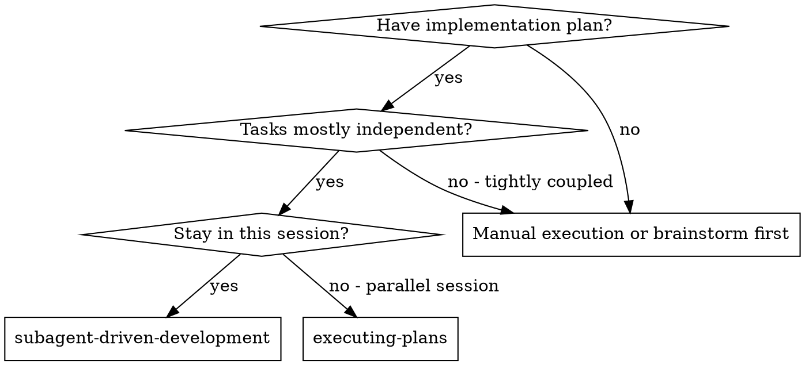
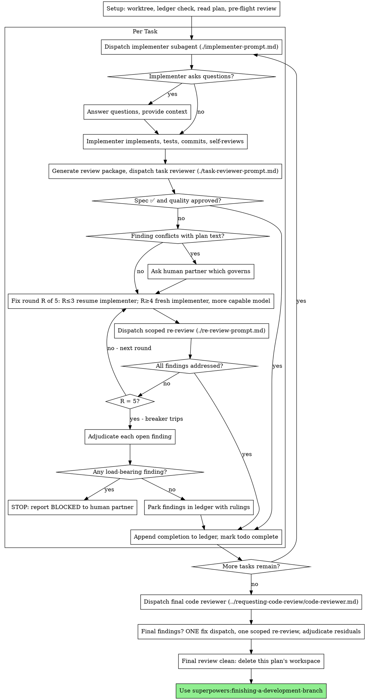

# Subagent-Driven Development

执行计划的方式:每个任务派一个全新的实现者子 Agent 去做,每做完一个任务就做一次任务评审(是否符合 spec + 代码质量),最后再对整条分支做一次全面评审。

**为什么用子 Agent:** 你把任务委派给上下文相互隔离的专职 Agent。通过精心设计它们的指令和上下文,你能确保它们专注并成功完成任务。它们绝不应该继承你这个会话的上下文或历史——你要精确地为它们构造出所需的一切。这样做还能把你自己的上下文留给协调工作。

**核心原则:** 每个任务一个全新的子 Agent + 任务评审(spec + 质量) + 最后的全面评审 = 高质量、快迭代

**旁白(Narration):** 工具调用之间,至多说一句简短的话——账本(ledger)和工具结果本身就是记录。

**持续执行:** 任务之间不要停下来跟你的人类搭档确认。把计划里的所有任务一口气执行完,不要停。只有以下几种情况才该停:遇到你无法解决的 BLOCKED 状态、真的没法往下走的歧义,或者所有任务都完成了。"要我继续吗?"这类询问和进度小结都是在浪费他们的时间——他们让你执行计划,那就执行。

## 何时使用



**对比 Executing Plans(并行会话):**
- 同一个会话(无需切换上下文)
- 每个任务一个全新的子 Agent(不污染上下文)
- 每个任务做完后评审(是否符合 spec + 代码质量),最后做一次全面评审
- 迭代更快(任务之间无需人工介入)

## 流程



## 准备工作(Setup)

确保工作发生在一个隔离的工作空间里:用 superpowers:using-git-worktrees 创建一个,或核实已有的那个。没有你人类搭档的明确同意,绝不要在 main/master 分支上开始实现。

对话记忆熬不过压缩(compaction)。在真实会话里,丢失了自己进度位置的控制器(controller)曾经把整段已经完成的任务序列又重新派发了一遍——这是观测到的代价最高的失败。用一个账本(ledger)文件来追踪进度,而不是只靠 todos。

- 每个计划各自拥有一个工作空间:在技能开始时,运行本技能的 `scripts/sdd-workspace PLAN_FILE`——它会打印出该计划专属的、被 git 忽略的目录(`<repo-root>/.superpowers/sdd/<plan-basename>/`),这里存放着**这个**计划的所有产物:账本、任务简报(brief)、报告、评审包(review package)。别的计划的目录永远轮不到你去读或写。
- 到 `<workspace>/progress.md` 检查这个计划的账本。如果它的第一行写的是你的计划文件,那么带有 `Task <N>: complete` 这一行的任务就是 DONE 了——别再重新派发它们;从第一个没有这行的任务处续跑。如果一个任务的最后一行是某个修复轮次(fix round),说明它正处于循环中途:从下一轮开始接着跑这个循环。如果一个账本的第一行写的是另一个计划文件——或者在旧的扁平路径 `.superpowers/sdd/progress.md` 处有个游离的账本——那是别的计划的进度:原样留着,自己重新起一个新的。
- 创建账本时,把它的身份写在第一行:`# SDD ledger — plan: <plan file path>`。
- 账本就是你的恢复地图:它记下的那些提交(commit)确实存在于 git 里,哪怕你的上下文已经不记得创建过它们。压缩之后,相信账本和 `git log`,别信自己的记忆。
- `git clean -fdx` 会摧毁这个工作空间(它是被 git 忽略的临时草稿区);万一发生了,从 `git log` 恢复。

把计划从头到尾读一遍,记下它的上下文和 Global Constraints(全局约束),并为每个任务建一个 todo。

在派发 Task 1 之前,先把计划整体扫一遍找冲突:

- 相互矛盾的任务,或与计划的 Global Constraints 矛盾的任务
- 计划明确要求、但评审标尺(rubric)会判定为缺陷的东西(比如一个什么都不断言的测试、逐字重复的逻辑块)

把你发现的一切作为**一个**打包好的问题呈现给你的人类搭档——每条发现都紧挨着强制它的那段计划原文,问以哪个为准——在执行开始之前问,而不是在计划执行途中每发现一处就打断一次。如果扫描是干净的,不用吭声直接往下走。评审循环仍然是那些只有在实现中才会浮现的冲突的兜底网。

## 模型选择

用能胜任每个角色的最弱的模型,以节省成本、提升速度。

**机械性的实现任务**(孤立的函数、清晰的 spec、1-2 个文件):用又快又便宜的模型。当计划写得足够明确时,大多数实现任务都是机械性的。

**集成与需要判断的任务**(多文件协调、模式匹配、调试):用标准模型。

**架构与设计任务**:用可用的最强模型。最后那次针对整条分支的评审就属于这一类——用可用的最强模型去派发它,而不是会话的默认模型。

**评审任务**:挑一个具备同等判断力的模型,并按 diff 的规模、复杂度和风险来缩放。一个小的机械性 diff 不需要最强的模型;一个微妙的并发改动则需要。对小修复 diff 的范围受限复审(scoped re-review)用便宜到中档的模型即可。

**修复循环的升级(第 4-5 轮)**:用一个至少比卡住的那个实现者高一档的模型(按模型选择规则)。

**派发子 Agent 时永远显式指定模型。** 省略模型会继承你会话的模型——往往是最强也最贵的那个——这会悄无声息地让本节的努力落空。

**轮次数比 token 单价更要紧。** 墙钟时间和上下文成本会随着子 Agent 花的轮次数增长,而最便宜的模型在多步骤工作上动辄多花 2-3 倍的轮次——总账反而更贵。把中档模型作为评审者、以及从散文描述出发工作的实现者的下限。当任务的计划原文里已经包含了要写的完整代码时,实现就是誊写加测试:这种实现者用最便宜的档。单文件的机械性修复也用最便宜的档。

**任务复杂度信号(实现任务):**
- 触及 1-2 个文件、spec 完整 → 便宜模型
- 触及多个文件、有集成方面的顾虑 → 标准模型
- 需要设计判断或对代码库的广泛理解 → 最强模型

## 任务循环

你粘进派发提示词里的一切——以及子 Agent 打印回来的一切——都会在这次会话余下的时间里常驻你的上下文,并在之后每一轮里被重新读取。把产物以文件形式交接。

### 1. 派发实现者

派发前记下 BASE(`git rev-parse HEAD`)——评审包和修复轮次的 diff 都需要它。

- **任务简报(Task brief):** 派发实现者之前,运行本技能的 `scripts/task-brief PLAN_FILE N`——它会把该任务的完整原文抽取到一个唯一命名的文件里并打印路径。组织派发内容时,让简报保持为需求的唯一来源。你的派发应包含:(1) 一行说明这个任务在整个项目里处于什么位置;(2) 简报路径,并这样引入它——"先读这个——它就是你的需求,里面有要逐字使用的确切值";(3) 早先任务里定下的、简报无从知晓的接口和决策;(4) 你对简报里注意到的任何歧义的处理决定;(5) 报告文件路径和报告约定。确切的值(数字、magic string、签名、测试用例)只出现在简报里。永远不要让子 Agent 去读整个计划文件。
- **报告文件(Report file):** 实现者的报告文件按简报来命名(简报 `…/task-N-brief.md` → 报告 `…/task-N-report.md`),并写进派发提示词里。实现者把完整报告写在那里,只返回状态、提交、一行测试小结和顾虑。
- 一份派发提示词只描述一个任务,不是会话的历史。别把累积的前序任务小结("Tasks 1-3 之后的状态")粘进后面的派发里——真实会话里有一次派发达到了 42k 字符,其中 99% 是粘贴进去的历史。一个全新的子 Agent 需要的是它的任务、它要触及的接口,以及全局约束。别的都不要。
- 如果早先某个任务把一条发现停放(park)在了这个任务要触及的区域,就在派发里带上指向那条账本条目的指针。
- 从派发结果里记下实现者的 Agent 身份——修复循环的第 1-3 轮要恢复(resume)这个 Agent。
- 永远不要并行派发多个实现子 Agent(会冲突)。

模板:[implementer-prompt.md](implementer-prompt.md)

### 2. 处理报告

实现子 Agent 会报告四种状态之一。分别妥善处理:

**DONE:** 生成评审包(`scripts/review-package PLAN_FILE BASE HEAD`,在本技能目录下运行——它会打印它写入的那个唯一文件路径;BASE 是你在派发实现者之前记下的那个提交——绝不要用 `HEAD~1`,那会悄无声息地丢掉一个多提交任务里除最后一次以外的所有提交),然后用打印出的路径派发任务评审者。

**DONE_WITH_CONCERNS:** 实现者完成了工作但标记了疑虑。往下走之前先读这些顾虑。如果顾虑关乎正确性或范围,评审前先处理掉。如果只是观察(比如"这个文件越来越大了"),记下来然后继续去评审。

**NEEDS_CONTEXT:** 实现者需要没被提供的信息。补上缺失的上下文并重新派发。

**BLOCKED:** 实现者无法完成任务。评估这个阻塞:
1. 如果是上下文问题,提供更多上下文,用同一个模型重新派发
2. 如果任务需要更多推理,换更强的模型重新派发
3. 如果任务太大,拆成更小的块
4. 如果是计划本身错了,上报给人类

**绝不要**忽略一次上报,也不要在不做任何改变的情况下逼同一个模型重试。如果实现者说它卡住了,那就有什么东西必须变。

如果实现者提问——无论是开始前还是任务中途——都清楚、完整地回答,需要就补充上下文,别急着把它推去实现。

### 3. 评审任务

每个任务的评审是任务范围内的关卡(gate)。全面评审只发生一次,在最后针对整条分支的评审里。永远不要跳过任务评审,也永远不要接受一份缺了任一裁决的报告——是否符合 spec **和**任务质量,两者都是必需的。实现者的自评永远替代不了任务评审;两者都需要。

- 把 diff 以文件形式交给评审者:运行本技能的 `scripts/review-package PLAN_FILE BASE HEAD`,把它打印出的文件路径传给评审者(或者,没有 bash 时:对该范围执行 `git log --oneline`、`git diff --stat` 和 `git diff -U10`,重定向到一个唯一命名的文件里)。这些输出永远不会进入你自己的上下文,而评审者只需一次 Read 调用就能看到提交列表、stat 摘要和带上下文的完整 diff。用你在派发实现者之前记下的那个 BASE——绝不要用 `HEAD~1`,那会悄无声息地截断多提交任务。永远不要在没有 diff 文件的情况下派发任务评审者。
- **评审者的输入:** 任务评审者拿到三个路径——同一个简报文件、报告文件和评审包——外加约束这个任务的全局约束。
- 你交给评审者的那段全局约束块就是它的注意力透镜。把约束性要求从计划的 Global Constraints 章节或 spec 里逐字抄过来:确切的值、确切的格式,以及各组件之间被言明的关系("与 X 布局相同"、"和 Y 匹配")。评审者的模板本身已经带了流程规则(YAGNI、测试卫生、评审方法)——约束块是给**这个**项目的 spec 所要求的东西。
- 别加"检查所有用到的地方"或"有用的话就跑竞态测试"这类没有具体、任务专属理由的开放式指令
- 别让评审者去重跑实现者已经在同一份代码上跑过的测试——实现者的报告已经带着测试证据
- 别替评审者预判发现——永远不要指示评审者忽略或不要标记某个具体问题。如果你觉得某条发现会是误报,让评审者提出来,在评审循环里去裁决它。如果你正在写的提示词里含有"不要标记"、"别把 X 当缺陷"、"顶多算 Minor"或"计划选择了"——停:你在预判,通常是为了替自己省掉一个评审循环。

任务评审者可能会报告"⚠️ 无法从 diff 验证"的条目——那些活在未改动代码里、或跨任务的需求。这些不阻塞评审的其余部分,但你必须在标记任务完成前逐条自己解决:你手里有计划和跨任务上下文,而评审者没有。如果你确认某条确实是真的缺口,就当成一次失败的 spec 评审——它和其他发现一起进入修复循环。

模板:[task-reviewer-prompt.md](task-reviewer-prompt.md)

### 4. 修复循环

当评审报告 spec ❌、任何 Critical 或 Important 发现,或一条你已确认为真实缺口的 ⚠️ 条目时,循环触发。

在循环开始前,有两条路径能让它立刻离开:

- 边走边把 Minor 发现记进进度账本里(`Task <N>: minor (deferred): <one-liner>`),并让最后的全面评审指向那份清单,好让它分诊(triage)出哪些必须在合并前修掉。一份没人读的汇总就是一次无声的丢弃。Minor 发现永远不进入循环。
- 一条被标为 plan-mandated(计划强制)的发现——或者任何与计划原文所要求的东西相冲突的发现——是人类的决定,和任何计划矛盾一样:把这条发现和计划原文摆出来,问以哪个为准。别因为计划强制就把这条发现打发掉,也别在没问的情况下派发一个与计划相冲突的修复。

其他所有东西都进入循环。一个修复轮次 = 一次修复派发加一次范围受限的复审。每个任务最多五轮:

**第 1-3 轮——恢复原来的实现者。** 把开放的发现逐字发给它。它的上下文是完整的:它知道任务、代码,以及自己做过的选择。如果你的运行环境没法给一个活着的子 Agent 再发一条消息,那就派发一个全新的实现者,带上简报路径、报告文件路径和这些发现——无论哪种方式,报告文件都是那份持久记忆。

**第 4-5 轮——在更强的模型上派发一个全新的实现者**(按模型选择规则),带上简报路径、报告文件路径、开放的发现,以及这样一段框定:"此前有个实现者尝试了这个任务 [N] 次;现在它归你了。读报告文件了解都试过什么。" 一个能扛过三次恢复的循环,通常意味着实现者看不见自己的问题——一步到位地换新视角加提升能力。

**每一轮,无论哪种方式:** 实现者做修复、重跑覆盖被改代码的测试、把它的修复报告追加到同一个报告文件里,并返回那份简短约定。在重新派发评审者之前,确认修复报告里含有覆盖用的测试、跑的命令和输出;三样都齐了才派发复审。在修复消息里点名覆盖用的测试文件——一个单行修复不需要跑整个测试套件。

**复审是范围受限的。** 运行 `scripts/review-package PLAN_FILE FIX_BASE HEAD`,其中 FIX_BASE 是上一次评审看到的那个 head,并用 [re-review-prompt.md](re-review-prompt.md) 派发,附上发现清单、简报、报告文件和打印出的 diff 路径。复审者对每条发现给出 ADDRESSED 或 NOT ADDRESSED 的裁决,并只在修复 diff 里标记新的破坏。修复 diff 里新出现的 Critical/Important 破坏加入开放发现清单。范围之外的观察作为延后的 minor 进入账本——它们永远不延长循环。

**每一轮之后**,追加到账本:
`Task <N>: fix round <R>/5 (<X> addressed, <Y> open — <finding one-liners>; commits <a7>..<b7>)`

永远不要在控制器会话里自己修复发现——你的上下文要保持干净以做协调,而且控制器的修复会跳过评审。

**断路器(The breaker)。** 当第 5 轮的复审仍留有开放发现时,停止派发。逐条自己裁决每一条开放发现——你手里有计划和跨任务上下文,而评审者没有:

- **评审者错了,或者这一点可争议:** 停放它——`Task <N>: parked — <finding> — ruling: <why the code stands>`。最后的评审能看到双方。
- **是真的,但下游没有东西建立在它之上:** 同样停放它,附一条裁决说明它是真的但已延后。
- **是真的且承重(load-bearing)**——后面某个任务建立在它之上,或者它暴露了一个计划缺陷:停。追加 `Task <N>: BLOCKED — <reason>`,并把这条发现、与它相撞的计划原文、以及修复历史一起上报给你的人类搭档。停放一个结构性失败,会让每一个依赖它的任务都建立在它之上,并把一个连最后评审也修不了的问题甩给它。

只在达到上限时才裁决。为了结束一个循环而提早裁决,只是换了个名字的预判。每一次裁决都是一条账本条目——无声的丢弃是被禁止的。

### 5. 完成任务

当评审干净地回来时——或者在上限处每一条开放发现都已停放并附裁决时——把完成行和你其他的记账一起,在同一条消息里追加到账本:

- `Task <N>: complete (commits <base7>..<head7>, review clean)`
- 断路器跳闸之后:`Task <N>: complete (commits <base7>..<head7>, <K> parked)`

然后把这个 todo 标记完成,继续下一个。当评审还有既没被修复、也没在上限处停放并附裁决的开放 Critical/Important 问题时,永远不要转去下一个任务。

## 最终评审

最后那次针对整条分支的评审也拿到一个包:运行 `scripts/review-package PLAN_FILE MERGE_BASE HEAD`(MERGE_BASE = 分支起始的那个提交,例如 `git merge-base main HEAD`),并把打印出的路径包含进最终评审的派发里,这样最终评审者读一个文件就好,而不用再用 git 命令重新推导分支 diff。在可用的最强模型上派发(见模型选择),使用 superpowers:requesting-code-review 的 [code-reviewer.md](../requesting-code-review/code-reviewer.md)。让它指向账本里的 deferred-minor 和 parked 这些行,好让它分诊出哪些必须在合并前修掉。

如果最后针对整条分支的评审返回了发现,用完整的发现清单派发**一个**修复子 Agent——不是每条发现派一个修复者。逐条发现的修复者各自都要重建上下文、重跑套件;真实会话里一次最终评审的修复浪潮,花费超过了它所有任务的总和。然后只跑一次范围受限的复审来审这波修复(对修复范围跑 `scripts/review-package PLAN_FILE FIX_BASE HEAD`,用 [re-review-prompt.md](re-review-prompt.md))。像任务循环的断路器那样裁决任何残留的发现:停放并附裁决,或者在承重的那些上停下来。没有第二波修复——残留的承重发现会在 finishing-a-development-branch 呈现选项时浮现给你的人类搭档。

## 收尾(Finish)

当最后针对整条分支的评审干净、且它的修复已合并时,删除这个计划的工作空间(`rm -rf <workspace>`)——现在 git 历史就是记录了。同级目录属于别的计划;别去动它们。

使用 superpowers:finishing-a-development-branch。

## 常见的自我合理化

| 借口 | 现实 |
|--------|---------|
| "spec 符合度上差不多够了" | 评审者发现了 spec 缺口 = 没完成。修掉,或者撞到上限去裁决——这是仅有的两个出口。 |
| "我自己修算了,派发太费事" | 控制器的修复会污染你的上下文并跳过评审。恢复实现者。 |
| "再来一轮就收敛了" | 过了上限,轮次不会收敛——这个失败是结构性的。裁决并分流。 |
| "评审者反正总能挑出新毛病" | 范围受限的复审只验证修复;它们没法乱逛。未改动代码上的新发现进账本,不进循环。 |
| "这条发现明显是错的,我把它丢掉" | 你只在上限处裁决,而且每一条裁决都是账本条目。无声的丢弃是被禁止的。 |
| "这个修复很小,跳过复审吧" | 未经评审的修复正是回归缺陷溜进来的方式。每一轮都以一次范围受限的复审结束。 |
| "评审拖慢了循环" | 没有评审的循环只是未经验证的空转。评审是这个循环的刹车和方向盘。 |
| "记账本是额外负担" | 账本才是熬过压缩活下来的东西。没有账本的控制器曾把整段已完成的任务序列重新派发了一遍。 |

## 工作流示例

```
You: I'm using Subagent-Driven Development to execute this plan.

[Setup: worktree verified]
[Read plan file once: docs/superpowers/plans/feature-plan.md]
[Resolve workspace: scripts/sdd-workspace docs/superpowers/plans/feature-plan.md — no ledger inside, fresh start]
[Create todos for all tasks]

Task 1: Hook installation script

[Run task-brief for Task 1; dispatch implementer with brief + report paths + context]

Implementer: "Before I begin - should the hook be installed at user or system level?"

You: "User level (~/.config/superpowers/hooks/)"

Implementer: [Later]
  - Implemented install-hook command
  - Added tests, 5/5 passing
  - Self-review: Found I missed --force flag, added it
  - Committed

[Run review-package PLAN_FILE BASE HEAD; dispatch task reviewer with the printed path]
Task reviewer: Spec ✅ - all requirements met, nothing extra.
  Strengths: Good test coverage, clean. Issues: None. Task quality: Approved.

[Ledger: Task 1: complete (commits a1b2c3d..d4e5f6a, review clean)]

Task 2: Recovery modes

[Run task-brief for Task 2; dispatch implementer with brief + report paths + context]

Implementer: [No questions]
  - Added verify/repair modes
  - 8/8 tests passing
  - Committed

[Run review-package PLAN_FILE BASE HEAD; dispatch task reviewer with the printed path]
Task reviewer: Spec ❌:
  - Missing: Progress reporting (spec says "report every 100 items")
  Issues (Important): Magic number (100)

[Fix round 1: resume the implementer with both findings]
Implementer: Added progress reporting, extracted PROGRESS_INTERVAL constant.
  Re-ran test/recovery.test.js — 10/10 passing. Fix report appended.

[Run review-package PLAN_FILE FIX_BASE HEAD; dispatch scoped re-review]
Re-reviewer: Missing progress reporting — ADDRESSED (src/recovery.js:41).
  Magic number — ADDRESSED (src/recovery.js:7). New breakage: none.
  Verdict: all findings addressed.

[Ledger: Task 2: fix round 1/5 (2 addressed, 0 open; commits d4e5f6a..b7c8d9e)]
[Ledger: Task 2: complete (commits d4e5f6a..b7c8d9e, review clean)]

...

[After all tasks]
[Run review-package PLAN_FILE MERGE_BASE HEAD; dispatch final code-reviewer, most capable model]
Final reviewer: All requirements met. Deferred minors triaged: none block merge.

[Delete this plan's workspace — the record now lives in git]

Done! Using superpowers:finishing-a-development-branch.
```
